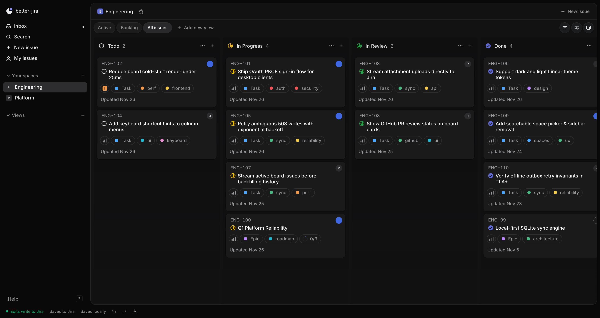
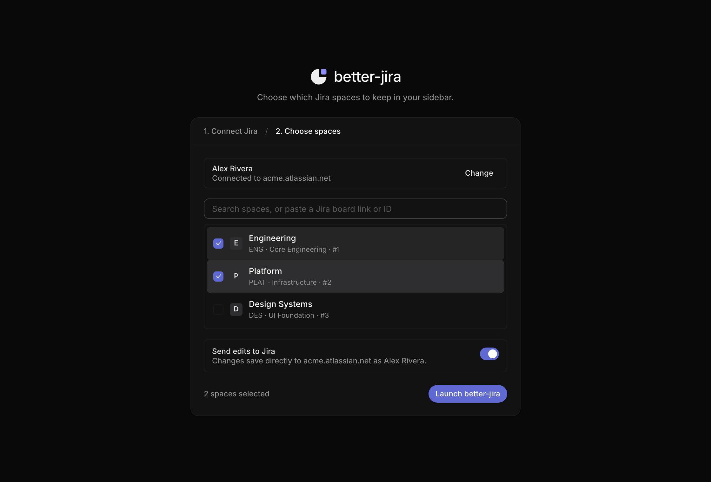
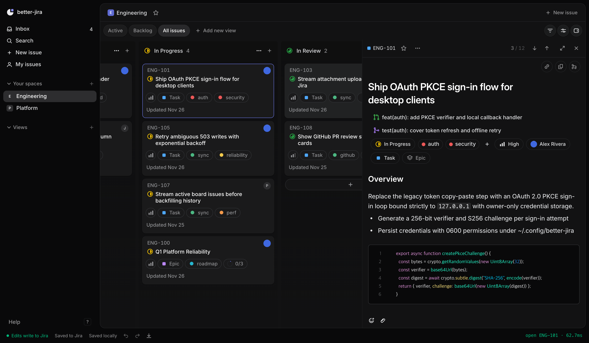
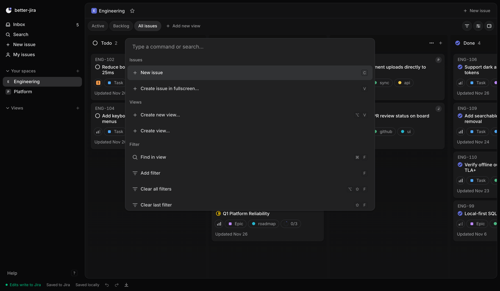
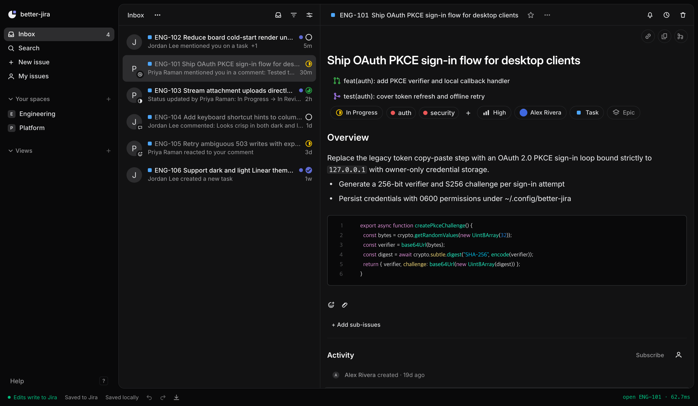

<div align="center">

<picture>
  <source media="(prefers-color-scheme: dark)" srcset="docs/screenshots/logo-dark.svg" />
  <source media="(prefers-color-scheme: light)" srcset="docs/screenshots/logo-light.svg" />
  
</picture>

<h1>better-jira</h1>

<p>
  <strong>A fast, Linear-inspired local UI for Jira Cloud Kanban boards.</strong><br />
  Runs on <code>127.0.0.1</code> with a local SQLite mirror for instant navigation, keyboard-first triage, and reliable two-way Jira sync.
</p>

<p>
  <a href="https://github.com/sairajchouhan/better-jira/actions/workflows/ci.yml"></a>
  <a href="https://github.com/sairajchouhan/better-jira/releases/latest"></a>
  <a href="./LICENSE"></a>
  
</p>

<p>
  <a href="#quick-start">Quick Start</a> &nbsp;·&nbsp;
  <a href="#features">Features</a> &nbsp;·&nbsp;
  <a href="#keyboard-shortcuts">Shortcuts</a> &nbsp;·&nbsp;
  <a href="#local-first--private">Security & Storage</a> &nbsp;·&nbsp;
  <a href="#development">Development</a>
</p>

<br />

<picture>
  <source media="(prefers-color-scheme: dark)" srcset="docs/screenshots/board-dark.png" />
  <source media="(prefers-color-scheme: light)" srcset="docs/screenshots/board-light.png" />
  
</picture>

<sub>Adapts automatically to dark and light mode. Active board issues load first while older history streams in the background.</sub>

</div>

<br />

## Why better-jira?

- **Local-first speed** — Mirrors your Jira Cloud boards into a local SQLite database (`cache.db`), so switching spaces, opening issues, filtering, and searching thousands of tickets happens in milliseconds instead of waiting on Jira page loads.
- **Keyboard-first ergonomics** — Command palette (<kbd>⌘K</kbd>), single-key triage (<kbd>S</kbd>, <kbd>A</kbd>, <kbd>P</kbd>, <kbd>L</kbd>), instant peek (<kbd>Space</kbd>), and saved views designed around Linear's workflow.
- **Reliable two-way sync (or read-only mode)** — Edits save optimistically in your browser and sync to Jira with offline retry, conflict detection, and [TLA+-verified](./specs) sync and inbox invariants. Prefer browsing without writes? Toggle **Send edits to Jira** off anytime.
- **100% local, zero cloud proxy** — Ships as a single standalone binary that binds strictly to `127.0.0.1`. Your Jira API token never leaves your machine except directly to your own Atlassian Cloud site.

---

## Quick Start

Install the standalone binary on **macOS** (`arm64` / `x64`) or **Linux** (`x64` / `arm64`) — no Bun, Node, or Git required:

```sh
curl -fsSL https://raw.githubusercontent.com/sairajchouhan/better-jira/main/install.sh | sh
better-jira
```

On first launch, `better-jira` opens a local setup wizard at `http://127.0.0.1:4747`:

1. Enter your **Jira Cloud site** (`https://your-team.atlassian.net`), **Atlassian email**, and a **Jira API token** (linked directly from the form).
2. Search and select the **Jira spaces** (Kanban boards) you want in your sidebar, and choose whether edits write back to Jira or stay local-only.
3. Click **Launch better-jira** — active issues load first so you can start working right away.

<p align="center">
  
</p>

Press <kbd>Ctrl+C</kbd> in your terminal to stop it anytime. Nothing runs in the background when you exit.

### CLI commands

```sh
better-jira                    # start on http://127.0.0.1:4747 and open your browser
better-jira --port 4748        # run on another local port
better-jira --instance work    # keep a separate Jira account/site under another profile
better-jira --no-open          # start without opening a browser tab
better-jira status             # show running status and config/cache paths
better-jira open               # open the running instance in your browser
```

---

## Features

### Rich issue peek, ADF editor & linked GitHub PRs

Inspect and edit issues right alongside your board or in full-screen view. Full Atlassian Document Format (ADF) descriptions, syntax-highlighted code blocks, inline property chips, epics (projects), fix versions (milestones), sub-issues, attachments, threaded comments, and live GitHub PR statuses stay in sync with Jira.

<p align="center">
  
</p>

### Command menu & multi-space sidebar

Press <kbd>⌘K</kbd> / <kbd>Ctrl+K</kbd> from anywhere to jump between spaces, filter boards, create issues, or search your entire local mirror instantly. Click **+** next to **Your spaces** (or run **Add space** in the command menu) to browse all Jira boards visible to your account and add or remove them in one click.

<p align="center">
  
</p>

### Split-pane Jira Inbox

Triage Jira mentions, comments, status changes, and reactions in a unified split-pane inbox with live issue previews, unread badges, and reliable read/unread syncing back to Jira.

<p align="center">
  
</p>

### What syncs to Jira

When **Send edits to Jira** is enabled (footer shows **Edits write to Jira**):

- **Fields:** title, rich ADF description, status, priority, assignee, labels, issue type, due date, epic, fix versions (milestones), estimate
- **Actions:** creating and deleting issues, comments (add, edit, reply, delete), issue links and web links, file/image attachments, drag-and-drop card ordering
- **Collaboration:** subscribing/watching an issue, marking inbox notifications read or unread
- **GitHub PRs (optional):** displays PRs linked in Jira plus GitHub PRs mentioning the issue key using your local `gh auth token` or `GITHUB_TOKEN` (read-only; set `GITHUB_PR_SOURCES=off` to disable)

> **Intentionally out of scope:** Sprints/cycles, story points, components, time tracking, bulk actions, templates, recurring issues, and real-time collaboration. `better-jira` is built specifically for fast Kanban workflows on Jira Cloud.

---

## Keyboard Shortcuts

| Shortcut | Action |
| :--- | :--- |
| <kbd>⌘</kbd> <kbd>K</kbd> / <kbd>Ctrl</kbd> <kbd>K</kbd> | Open command menu |
| <kbd>⌘</kbd> <kbd>/</kbd> / <kbd>Ctrl</kbd> <kbd>/</kbd> | View all keyboard shortcuts |
| <kbd>C</kbd> | Create new issue |
| <kbd>/</kbd> | Instant search across cached issues |
| <kbd>Space</kbd> / <kbd>Enter</kbd> | Peek issue / open full issue view |
| <kbd>S</kbd> · <kbd>A</kbd> · <kbd>P</kbd> · <kbd>L</kbd> | Change Status · Assignee · Priority · Labels |
| <kbd>F</kbd> | Add filter |
| <kbd>G</kbd> then <kbd>M</kbd> | Go to **My issues** |

---

## Local-First & Private

`better-jira` separates credentials/config from rebuildable cache following XDG conventions:

| Path | Contents | Notes |
| :--- | :--- | :--- |
| `~/.config/better-jira/instances/<name>/credentials.env` | `JIRA_EMAIL` and `JIRA_TOKEN` | Owner-only (`0600`) permissions |
| `~/.config/better-jira/instances/<name>/settings.json` | Jira site URL, selected board IDs, write toggle | Plain JSON, no secrets |
| `~/.cache/better-jira/instances/<name>/cache.db` | Local SQLite mirror of your boards | Safe to delete anytime for a clean re-sync |
| `~/.cache/better-jira/instances/<name>/trips.jsonl` | Local log of links opened in Jira | Local diagnostics only |

- Binds strictly to `127.0.0.1` — never listens on LAN/public interfaces.
- Release binaries include SHA-256 checksums (`checksums.txt`) verified automatically by `install.sh`.
- See [SECURITY.md](./SECURITY.md) for the full threat model and vulnerability reporting instructions.

---

## Development

Requires [Bun](https://bun.sh):

```sh
git clone https://github.com/sairajchouhan/better-jira.git
cd better-jira
bun install

# Try the full UI immediately with synthetic fixture data (no Jira account needed):
bun scripts/fixture-server.ts

# Or build the standalone binary locally:
bun run build:binary
./dist/bin/better-jira
```

See [CONTRIBUTING.md](./CONTRIBUTING.md) for running unit tests, linting, Playwright E2E suites, and TLA+ sync model verification.

---

## License

[MIT](./LICENSE)
